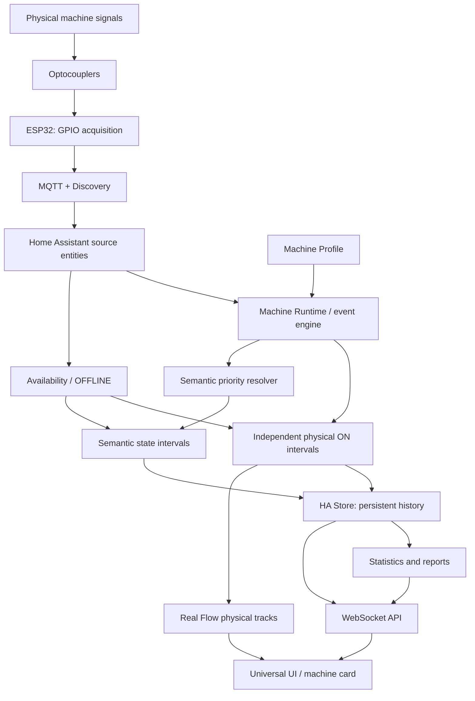

# Architecture / Архитектура

## Data boundaries

The ESP32 only observes raw inputs. It does not assign work/heating/idle meanings and does not control equipment. The HA integration consumes source entities rather than relying on an ESP32-specific event topic.

Machine Profile is the canonical configuration: input names, categories, priorities, colors, enabled/visible flags, statistics settings, row order, retention and shifts. Physical histories remain independent even when semantic priorities select only one current machine state.

OFFLINE is a historical interval of unknown activity. Availability loss closes uncertain physical ON intervals. A newly confirmed ON after recovery starts a new interval. No activity is reconstructed inside the gap.

History schema 4 stores separate `intervals` and `input_intervals`, plus observation metadata. Legacy semantic-only histories load without fabrication of missing physical data. HA Store writes are atomic and serialized outside the event loop; retention pruning runs at startup/daily and when retention decreases.

## Main modules

| Module | Responsibility |
|---|---|
| `config_flow.py`, `models.py` | Configuration and profiles |
| `coordinator.py`, `machine.py`, `event_engine.py` | Runtime, source updates and state resolution |
| `source_validation.py` | Source validation, including avoiding own diagnostic entities |
| `storage.py` | Independent persistent histories and retention |
| `stats.py`, `reports.py` | Period totals, comparisons and shifts |
| `sensor.py`, `binary_sensor.py` | HA diagnostic entities |
| `websocket_api.py` | UI data and report requests |
| `frontend_setup.py`, `dashboard.yaml` | Static module, resources and sidebar dashboard |
| `frontend/machine_monitor_card.js` | Overview, machine UI, standalone card, editor and UI localization |

## Updates

Source state changes emit integration update events. The frontend coalesces bursts with a 250 ms debounce. Polling every 5 seconds is a fallback; a local one-second timer updates displayed elapsed durations. Changing display filters, zoom or UI language does not rewrite history.

Frontend module URLs use a content hash to invalidate cached resources. Language preference is browser-local; names from Machine Profile and source IDs are preserved.

Persistent data belongs to Home Assistant `.storage` and is not part of this repository. See root `AGENTS.md` for the complete engineering specification.

## Acquisition enable metadata (1.3.0 / firmware 1.2)

A profile may bind one to four sources. Missing slots are omitted, never filled with fake OFF values. ESP32 retains four stable MQTT discovery identities, with per-line availability and a retained JSON `acquisition_enabled` attribute. Disabled acquisition yields an unavailable source entity; it does not publish fabricated OFF measurements. Existing sources without the optional attribute remain enabled for compatibility.

Effective observation permission is `InputConfig.enabled AND acquisition_enabled`. The persistent profile retains the user's own permission and canonical name. The event engine evaluates source attributes from each delivered HA state event (including attribute-only changes), closes physical ON intervals when permission disappears, and resumes only on a valid ON event. Only effectively enabled sources affect priority and the machine availability decision. Disabling every source gives OFFLINE/no_enabled_inputs.

The API exposes profile_enabled, acquisition_enabled and effective enabled separately. Historical intervals and statistics remain stored; toggles affect future acquisition, not historical facts. Existing filters can reveal a disabled input's past activity. No storage schema change, source-specific MQTT subscription, control output, or semantic engine in firmware is introduced.

## Universal modes and accounting (1.4.0)

Profiles store `rules`: named modes with category, priority, enabled permission, accounting and an OR of AND condition groups. Each term tests an enabled, available source for confirmed ON/OFF. Bounds are 32 modes, 16 groups and four terms per group. No expression interpreter, polling loop or firmware semantics is added. Enabled rules replace the legacy individual-input semantic winner; unmatched rules use the profile fallback. Availability takes precedence. Physical acquisition and history remain independent.

Semantic intervals snapshot `input_label`, `rule_id`, `accounting` and `included`. Accounting changes split the semantic interval at the edit instant without splitting physical ON. Schema 1–3 migration pins legacy category-based accounting before new rules run. Reports and statistics use the interval snapshot. Profile names reach the UI through backend metadata, never HA diagnostic friendly_name.

Schema 4 is forward incompatible with older integration versions. Preserve a pre-upgrade backup of Machine Monitor `.storage` profiles/history before downgrade; older code must not overwrite the upgraded history. The HA Store envelope version remains unchanged; history schema is versioned in the payload.

Real Flow grouping (<10 seconds) is browser-only, per physical row, cached, and reversible. It retains transparent/unknown gaps and exact ON totals. Dense groups use bounded hatch styles. It never changes persistent intervals or productivity statistics. Events sort by instants rather than lexical timezone representations.
